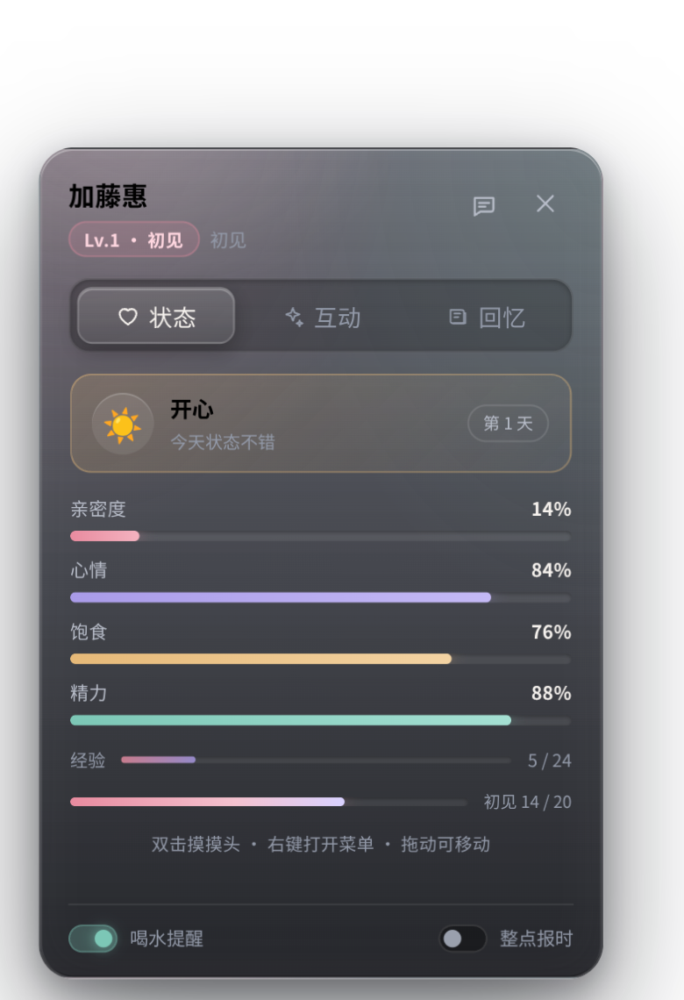
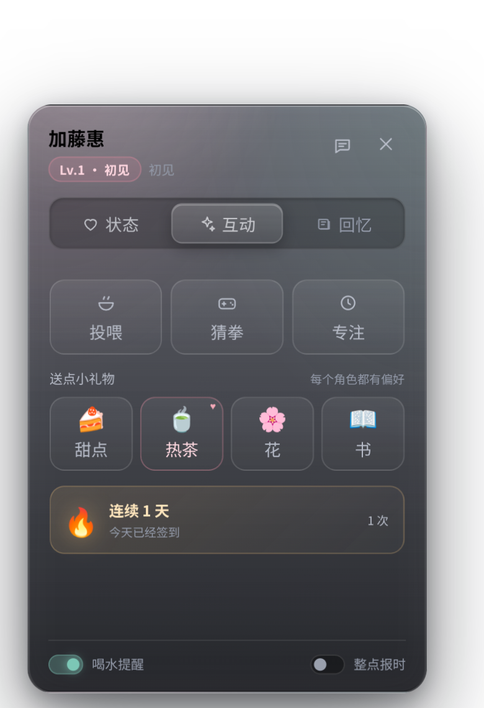
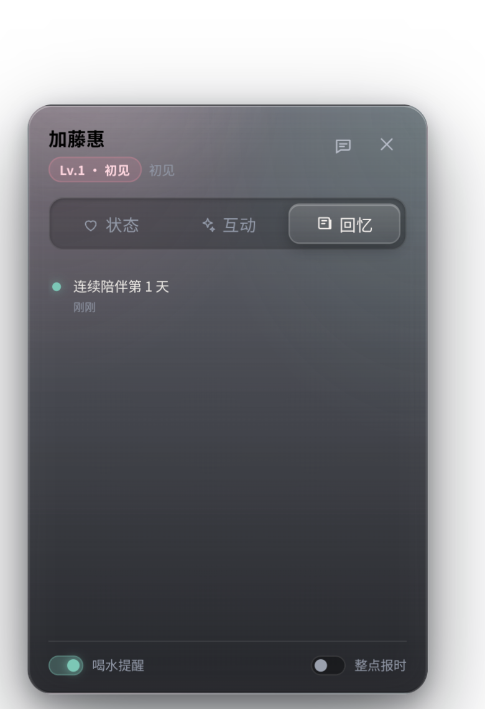

# AnimePet v3 · 陪伴中心（Tab 动效 + 情感培养）

> `/orch-add-feature` 的 Phase 1–2 产物（Research → Plan）。Size = **standard**（3–5 文件、跨 HTML/CSS/JS、无新依赖）。
> Gate 1 由用户的最新指令视为已授权执行；Gate 2 不提交（用户未要求 commit）。

## 1. Research

- Telegram Android 的 tab 切换（[Telegram attachment menu 研究](https://github.com/slopus/happy/blob/3ef5325dbea2e4caa17c637d1bd1e89d8f71b2d2/packages/happy-android/research/attachment-menu.md)）：
  - 弹簧参数 `damping 0.75 / stiffness 350`；tab 依次 pop-in，`scale 0 → 1.1`，`EASE_OUT(0,0,.58,1)`，相邻 tab 延迟 32ms。
  - 新版 Android 12.4 采用底部导航 + 圆角 + Liquid Glass 质感（[报道](https://pepelac.news/en/posts/id26150-telegram-12.4-update-for-android-new-design-and-features)）。
  - 浮动 pill tab bar 的点击反馈是 `scale 1.2 → 0.93 → 1.0`，选中项有白色卡片 / 彩色图标（[react-native-telegram-tabbar](https://www.npmjs.com/package/react-native-telegram-tabbar)）。
- 本项目现状：HUD 是单页（四维 + 按钮 + 开关），聊天是独立面板；没有 tab、没有礼物、没有回忆/里程碑、没有每日签到。

## 2. Design

### 2.1 陪伴中心（HUD 重构）

`#pet-hud` 从单页升级为 3 个 tab 的面板：

| Tab | 内容 |
| --- | --- |
| 状态 | 心情卡（emoji + 状态 + 陪伴天数）、四维、经验、亲密度阶段进度 |
| 互动 | 投喂 / 猜拳 / 专注、4 种礼物、连续陪伴卡、专注计时 |
| 回忆 | 陪伴日记（最近 40 条：初见、礼物、升级、里程碑、专注完成、每日签到） |

### 2.2 Tab 动效（Telegram 风格）

- 选中指示器是浮动 pill，`transform: translateX(calc(index * (100% + gap)))`，`cubic-bezier(.22,1.28,.36,1)` 360ms（轻微过冲）。
- 内容页按切换方向水平滑入（`--page-shift ±18px`），220–280ms `ease-out`。
- 图标点击回弹：`scale 1 → 1.18 → .94 → 1`（420ms），label 颜色渐变。
- 弹簧参数等价于 CSS 的 `cubic-bezier(.34,1.56,.64,1)`；相邻按钮 transition-delay 24ms 模拟 stagger。
- 全部动画在 `prefers-reduced-motion` 下关闭。

### 2.3 情感培养（数值层 v3）

状态文件升级到 v3（沿用同一 localStorage key，自动迁移）：

- **心情状态机** `moodInfo()`：`sweet / happy / calm / low / hungry / sleepy`，由四维推导；影响 HUD 配色、待机台词、气泡。
- **亲密度阶段** `stageInfo()`：初见(0) / 熟悉(20) / 亲近(40) / 喜欢(60) / 依恋(80) / 心意相通(100)，HUD 显示阶段与进度。
- **礼物系统**：甜点 🍰、茶 🍵、花 🌸、书 📖；每个模型有偏好（加藤惠=茶、蕾姆=甜点、惠惠=书、达克妮丝=花、阿克娅=茶）。偏好 +8 亲密/经验，普通 +3；20 秒冷却；写入回忆。
- **每日签到与连续天数**：首次互动当天 +2 亲密 +5 经验，连续天数按昨天是否来过累加，写入回忆。
- **里程碑**：亲密度达到 20/40/60/80/100 时解锁，气泡 + toast + 爱心粒子 + 回忆记录。
- **回忆日记**：`journal[]` 最多 40 条，时间戳 + 类型 + 文案；HUD 回忆页按相对时间展示。

### 2.4 灵动细节

- 摸头 / 投喂 / 礼物 / 里程碑触发爱心粒子（DOM 漂浮，900ms，低开销）。
- 数值变化做 400ms 数字滚动（`requestAnimationFrame`，reduced-motion 下直接赋值）。
- 心情卡呼吸光晕；连续陪伴火焰脉冲。
- 回忆新条目入场动画；空状态有引导文案。

## 3. 任务清单（thin vertical slices）

1. `pet-state.js`：v3 schema + 迁移；`moodInfo/stageInfo/addGift/checkDaily/note/checkMilestones`；礼物、签到、里程碑事件。
2. `index.html`：HUD 重构为 header + tabs + 3 pages + focus + foot；礼物按钮、回忆列表、心情卡、阶段条。
3. `pet.css`：tab bar / indicator / 页面过渡 / 礼物 / 回忆 / 心情卡 / 爱心粒子 / 数字滚动 / reduced-motion。
4. `pet-ui.js`：tab 控制器（含键盘方向键）、礼物交互、回忆渲染、心情/阶段渲染、签到与里程碑监听、爱心粒子。
5. `pet-interact.js`：按心情切换待机台词；摸头/逗弄触发爱心粒子。
6. 验证：`cargo test`、`node --check`、无头 Chrome 断言（tab 指示器位移、礼物加成、日记条目、签到幂等、里程碑事件、reduced-motion）。

## 4. 界面预览

| 状态 | 互动 | 回忆 |
| --- | --- | --- |
|  |  |  |

## 5. 验收

- [x] Tab 切换有滑动指示器 + 内容方向性入场，键盘左右键可切换
- [x] 礼物偏好加成正确，冷却生效，回忆新增条目
- [x] 每日签到只发一次，连续天数正确
- [x] 亲密度跨过 20/40/60/80/100 时触发一次里程碑
- [x] HUD 心情卡/阶段条/天数与实际状态一致
- [x] 现有聊天、专注、投喂、猜拳、热区并集不回归

## 6. 验证结果（2026-11-08）

| 项目 | 结果 |
| --- | --- |
| `cargo test` | 20 passed |
| `node --check` | pet-state / pet-ui / pet-interact / chat / message / cubism3 全通过 |
| 无头 Chrome 断言 | 22/22 PASS（tab 指示器、页面动画、礼物偏好与冷却、里程碑、签到幂等、键盘切换、爱心粒子、零脚本错误） |
| 真机冒烟 | v2 localStorage 自动迁移到 v3；state.json 含 journal/gifts/milestones；退出正常 |
| 视觉验收 | 三页截图无溢出；互动页礼物偏好在热茶上显示 ♥；回忆页条目按类型着色 |

## 7. 已知取舍

- 数字滚动动画在无头/虚拟时间下会卡在中间值，已改为直接赋值，依靠进度条宽度过渡提供动效。
- Tab 页固定 292px 高，内容滚动；避免切换时面板高度跳动影响输入热区。
- 礼物 emoji 属于游戏符号，与界面按钮的矢量图标规范区分。
