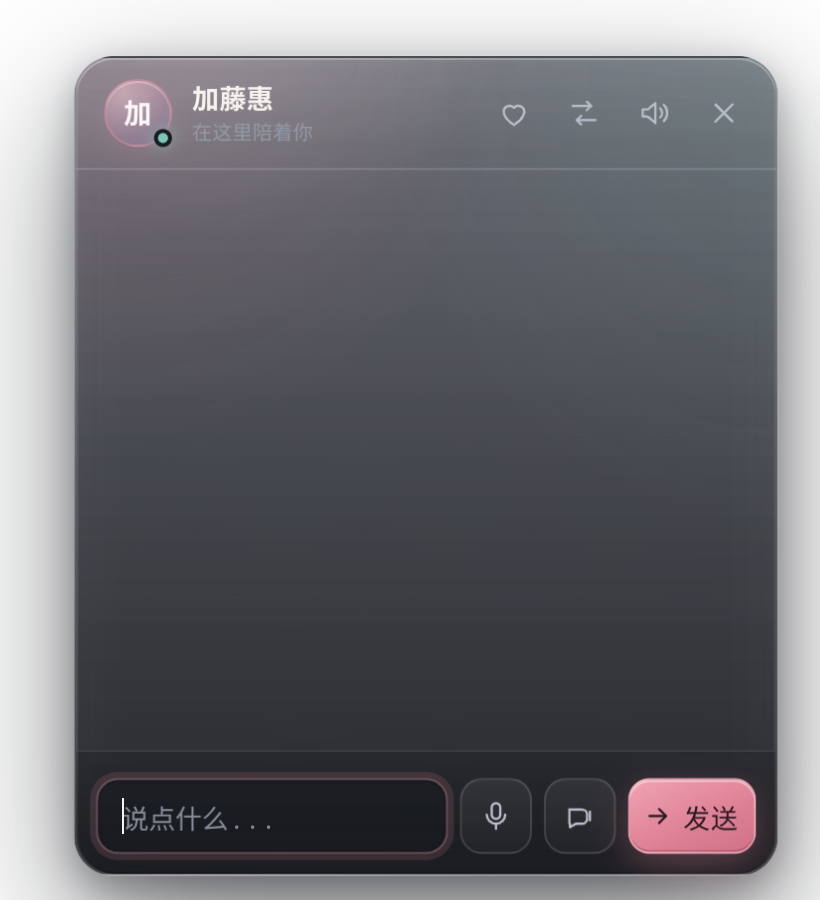
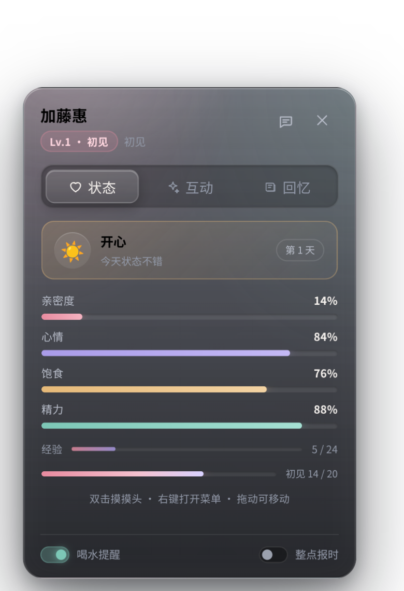
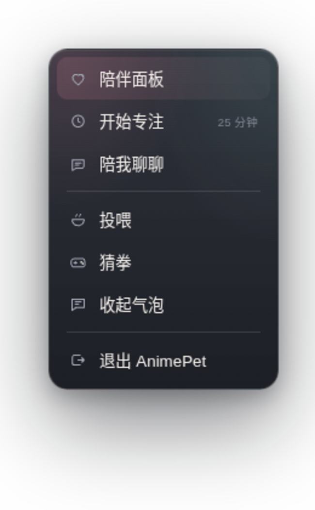
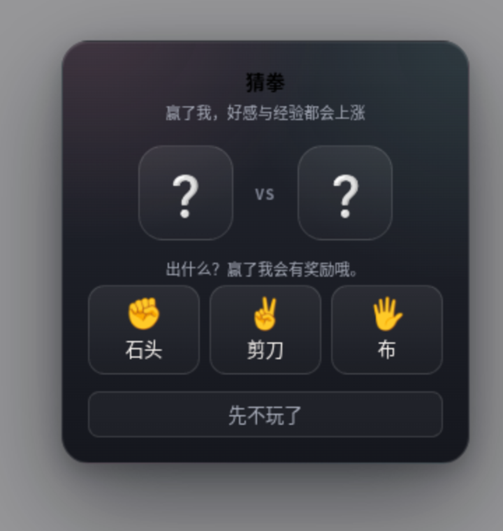

# AnimePet v2 · 陪伴系统与界面升级

> 本文是 ECC `feature-dev` 流程的设计产物：Discovery → Codebase Exploration → Architecture → Implementation → Review。
> 目标：参照 Desktop Mate / VPet / Shimeji / Catopia 等主流桌宠的能力，在现有 Rust + GTK3 + WebKitGTK + Live2D 架构上做功能再开发，并把按钮与面板 UI 重做。

## 1. 现状盘点

| 层 | 位置 | 说明 |
| --- | --- | --- |
| 窗口 | `src/main.rs` `build_ui` | layer-shell Overlay 全屏窗口，输入热区只覆盖模型矩形；通过 `document.title` 与前端通信（`drag_start` / `drag_end:l,b` / `chat_open` / `chat_close:l,b`） |
| HTTP | `src/main.rs` `start_chat_server` | 本地 `127.0.0.1:17364`：`/chat`、`/tts`、`/stt`，其余走静态资源 |
| 前端 | `assets/katoumegumi/index.html` | 内联 CSS + 内联聊天/拖拽脚本；Live2D 由 `js/message.js` 管理 5 个模型 |
| 人格 | `souls/*/SOUL.md` | 按模型加载 |

主要短板：

1. 除聊天外没有可玩性：没有数值、没有互动反馈、没有提醒，桌宠只是一个"会聊天的立绘"。
2. 交互只有「单击开聊天 / 拖拽」，没有摸头、投喂、抛掷、右键菜单。
3. 按钮全是 emoji 字符 + 基础方块样式，Windows/Linux 字体渲染不一致，视觉廉价。
4. 状态、设置、专注等能力无入口。
5. jQuery 走公网 CDN，离线时整个桌宠脚本直接挂掉。

## 2. 对标与取舍

| 竞品 | 可借鉴点 | 本项目取舍 |
| --- | --- | --- |
| Desktop Mate | 语音台词、闹钟、跟随 | 做提醒 + TTS 播报，不做 3D 跟随（layer-shell 拖拽已够） |
| VPet | 饥饿/心情/精力、喂食玩耍、等级 | 做轻量四维数值 + 等级称号，不做工作/学习模拟 |
| Shimeji | 抓取抛掷、待机小动作 | 做抛掷物理 + 待机随机小动作，不做攀爬窗口 |
| Catopia | 亲密度、忽视会掉状态 | 做随时间衰减 + 离线结算，不做"离家出走"惩罚 |
| Bobby / Bibo | 小游戏、提醒、系统联动 | 做猜拳小游戏 + 桌面通知 + 退出入口 |

## 3. 功能清单（v2）

### 3.1 陪伴数值
- 四维：`hunger` 饱食、`mood` 心情、`energy` 精力、`affection` 亲密度（0–100）。
- `exp` 累积 → `level`，等级对应称号（初见 / 点头之交 / … / 命运同行）。
- 随时间衰减：饱食 −4/h、精力 −2.5/h，心情向饱食与精力的均值回归；离线最多结算 24h。
- 行为奖励：摸头 +1 exp、投喂 +3 exp/+2 亲密、猜拳胜 +6 exp、专注完成 +12 exp、聊天 +1 exp。

### 3.2 桌面互动
- **单击**：打开聊天（保留 v1 行为，280ms 内不会重复触发）。
- **双击头部**：摸头 → 气泡 + 心情/经验；**双击身体**：原地转圈逗弄 → 另一套台词。
- 说明：摸头/逗弄之所以绑定双击而不是单击，是为了不破坏"点击桌宠聊天"的既有习惯。
- **拖拽抛掷**：松手按速度做重力 + 回弹 + 摩擦，落地后保存位置。
- **右键菜单**：状态面板 / 开始专注 / 陪我聊聊 / 投喂 / 猜拳 / 隐藏气泡 / 退出。
- **待机**：45–90 秒无交互时随机小跳与本地台词（不依赖网络）。

### 3.3 陪伴面板（HUD）
- 角色名 + 等级称号 + 四维进度条 + 经验条。
- 快捷动作：投喂 / 猜拳 / 专注 25 分钟。
- 专注计时：25 分钟倒计时，完成时气泡 + 语音 + 桌面通知 + 奖励；可中止。
- 开关：喝水提醒（45 分钟一次）、整点报时。

### 3.4 猜拳小游戏
- 石头 / 剪刀 / 布，胜 +6 exp +2 亲密 +4 心情，平 +2 exp，负 −0 心情但给一句安慰。

### 3.5 系统联动（Rust 新增接口）
| 方法 | 路径 | 作用 |
| --- | --- | --- |
| GET | `/state` | 读取 `~/.local/share/animepet/state.json` |
| POST | `/state` | 原子写入陪伴状态（≤64 KB，必须是 JSON 对象） |
| POST | `/notify` | 调用 `notify-send` 发桌面通知 |
| POST | `/app/quit` | 通过 GTK 主循环安全退出 |

### 3.6 UI 重做
- 用 inline SVG 图标替换 emoji（模型/音量/关闭/麦克风/语音模式/发送/状态/专注/投喂/猜拳）。
- 玻璃质感按钮：渐变底、内高光描边、hover 抬升、active 压下、`:focus-visible` 焦点环、CSS tooltip。
- 聊天面板 18px 圆角、顶部角色徽记、消息入场动画、细滚动条。
- 对话气泡重做：更柔和的毛玻璃 + 指向小尾巴。
- 新增 HUD / 右键菜单 / 猜拳弹窗 / 提醒 toast 的完整样式，全部响应 `prefers-reduced-motion`。

### 3.7 5 个内置模型
加藤惠、蕾姆（SDK2 .moc）与惠惠、达克妮丝、阿克娅（Cubism 3/4 .moc3）。SDK2 画布 280×300，
Cubism3 画布 280×250 贴底放置；选择保存在 `localStorage`。

### 3.8 健壮性
- jQuery 本地化到 `js/vendor/jquery.min.js`，离线可用。
- `index.html` 内联脚本拆分为 `js/chat.js`、`js/pet-state.js`、`js/pet-ui.js`、`js/pet-interact.js`。
- 保留 `document.title` 通信协议；浮层用 id 集合登记（同一 id 幂等），聊天优先申请键盘焦点；
  输入热区取「模型 + 可见浮层」矩形的并集，未覆盖的桌面区域保持穿透。

## 4. 模块与数据流

```
index.html
├─ css/pet.css            设计令牌 + 全部组件样式
├─ js/pet-state.js        数值/等级/衰减/持久化(localStorage + /state)
├─ js/pet-ui.js           HUD / 菜单 / 猜拳 / 专注 / 提醒 / TTS 桥
├─ js/pet-interact.js     手势 / 抛掷物理 / 待机行为 / 右键
├─ js/chat.js             原聊天逻辑 + 语音合成播放（暴露 animePetSpeak）
└─ js/message.js          Live2D 模型管理（保持）
```

状态写入节流 3 秒一次 `POST /state`；启动时以 `lastSeen` 较新的一方为准（本地 / 远端）。

## 5. 界面预览

| 聊天面板 | 陪伴面板 |
| --- | --- |
|  |  |

| 右键菜单 | 猜拳 |
| --- | --- |
|  |  |

## 6. 验收标准

- [x] `cargo build` 通过，`cargo test` 全绿。
- [x] 所有前端脚本通过 `node --check`。
- [x] 按钮在 hover / active / focus 下有明确视觉反馈，图标为矢量。
- [x] 投喂、摸头、猜拳、专注、提醒、右键菜单可用，数值随交互变化并持久化。
- [x] 重启后数值、等级、专注状态、模型选择、静音状态均恢复。
- [x] 浏览器截图验收：聊天面板、HUD、菜单、猜拳弹窗无溢出/错位。

## 7. 验收结果（2026-11-08）

| 项目 | 结果 |
| --- | --- |
| `cargo build` | 通过（v0.2.0） |
| `cargo test` | 20 passed / 0 failed（新增区域解析测试） |
| `node --check` | `pet-state.js` / `pet-ui.js` / `pet-interact.js` / `chat.js` / `message.js` 全部通过 |
| 无头 Chrome 断言 | 16/16 PASS：模型高度、热区并集、投喂、猜拳、专注、菜单、HUD、焦点、按钮样式、零脚本错误 |
| 真机运行（niri / 1920×1080） | 启动正常，Aqua 模型渲染、引导气泡显示、输入热区正确 |
| `/state` GET/POST | 200，落盘 `~/.local/share/animepet/state.json`，内容为合法 JSON |
| `/notify` | 200，`notify-send` 调用成功 |
| `/app/quit` | 200，进程在 2 秒内退出 |
| 窄屏 480px | 聊天面板收缩到 352px，输入区与按钮无溢出 |
| 模型切换 | 加藤惠 → 蕾姆 → 惠惠（Cubism3）连续切换成功，无脚本错误 |
| 专注完成 | 1.2 秒测试计时到点后 exp +12、计时器清空、无脚本错误 |
| 本地持久化 | 同一 WebKit profile 两次加载，饱食/经验状态保持一致 |

## 8. 代码审查与修复（2026-11-08）

独立 review agent 审阅 23 项，Critical / Important 全部修复并回归：

| 级别 | 问题 | 修复 |
| --- | --- | --- |
| Critical | 拖拽没有上边界，模型拖出屏幕上方后输入热区消失，窗口彻底穿透 | `applyPosition` 与抛掷积分器同时 clamp `bottom ∈ [0, innerHeight-MODE_HEIGHT]` |
| Critical | 抛掷竖直方向反了（屏幕 y 向下 vs bottom 向上） | 释放时改为 `finishThrow(speed.x, -speed.y)`，实测向上抛出 `bottom=200` |
| Critical | `pointerId` 不匹配时 `dragging` 永远为 true，`drag_start` 无法配对 `drag_end` | `onUp` / `onCancel` 先收尾再恢复热区，并新增 `window blur` 兜底 |
| Critical | `/state` 与 `/app/quit` 可被任意网页 CSRF 调用 | 每次启动生成一次性 token 注入同源 HTML，敏感写接口校验 `X-AnimePet-Token` + 本机 Host |
| Important | 右键菜单复用了 `chat_open`，会抢键盘焦点并抬升窗口 | 新增 `overlay_open`：只清输入热区，不设置键盘/焦点 |
| Important | 从远端恢复状态时 `lastTick` 被本地覆盖，离线衰减丢失 | 不再 max 本地 `lastTick`，采用远端后重新结算衰减 |
| Important | 右键打开陪伴面板时会与聊天面板重叠 | 聊天与 HUD 互斥，互相打开时自动关闭对方 |
| Important | 满级后经验显示 `4000 / 3350` | `levelInfo` 返回 `max`，HUD 显示 `MAX` |
| Important | `notify-send` 参数缺 `--`，且无节流 | 加 `--` 分隔 + 全局每分钟 1 条 |
| Important | 猜拳弹窗无焦点管理；菜单 `role=menu` 无方向键支持 | 打开聚焦首个选项、Tab 陷阱、关闭恢复焦点；菜单降级为 `role=group` |
| Important | 聊天流式增量触发 live region 反复播报 | 流式期间 `aria-live=off`，结束后通过隐藏 `role=status` 播报整段 |
| Nice | 菜单焦点态与 hover 无法区分 | `focus-visible` 加内描边焦点环 |
| Nice | 拖拽后 `suppressClick` 吞掉全页点击 | 仅拦截桌宠区域并单次清除 |
| Nice | 单击后立即拖拽会在拖拽途中弹聊天 | `pointerdown` 清除未决 tap 计时 |
| Nice | 气泡重叠时旧 `.delay()` 链会隐藏新气泡 | 统一 `stop(true,true)` + 清理自定义 timer |
| Nice | 退出前最多丢 3 秒状态 | `quitApp` 先 `state.save()` |

回归：`cargo test` 19 项全绿，扩展 QA 18/18 PASS（含 overlay 标题、焦点、投喂、猜拳、专注），追加抛掷方向与上边界测试通过。

## 9. 反馈修复：热区穿透与模型裁切（2026-11-08）

### 9.1 打开聊天后其他区域点不了
原因：`chat_open` 会把 GTK 输入热区清空成全屏，聊天面板之外因此全部被透明窗口吃掉。

修复：新增 `region:` 标题协议。前端把「模型矩形 + 当前可见浮层矩形」以 CSS 像素拼成 `x,y,w,h;x,y,w,h` 发给 Rust，Rust 用 `cairo::Region` 求并集后调用 `input_shape_combine_region`。效果：

- 聊天窗打开：只有模型 + 聊天面板可点，其他桌面区域正常穿透；
- 陪伴面板 / 右键菜单：只有模型 + 面板可点；
- 猜拳：整屏模态，`modal_open` 清空热区并申请键盘焦点（Tab / Enter 可用），关闭后恢复；
- 拖拽期间暂停热区更新（`pauseRegion`），松手后重新按并集计算；
- 热区更新合并到 `setTimeout(0)`，不用 rAF（WebKitGTK 窗口不可见时 rAF 会被节流）。

### 9.2 雷姆头部被裁切
原因：模型画布固定 280×250，而蕾姆模型按 `layout.width=2.0` 缩放后的实际高度超过 250，头顶被画布上沿裁掉。

修复：画布与 `#landlord` 高度统一提升到 300px，Rust `MODEL_HEIGHT` 同步为 300，JS 的拖拽/抛掷上限改为读取 `#landlord.offsetHeight`（不再写死 250），气泡上移到 `bottom: 296px`；Cubism3 的 PIXI 画布保持 280×250 并改为 `bottom: 0` 贴底，保留原有观感。逐个模型截图确认：加藤惠、蕾姆、惠惠、达克妮丝、阿克娅头部完整，底部仍与屏幕下沿对齐。

### 9.3 回归
`cargo test` 20 项全绿；无头 QA 16/16；真机启动日志显示热区 `308x328`（300 高 + 14 内边距），状态持久化与 `/app/quit` 正常。
