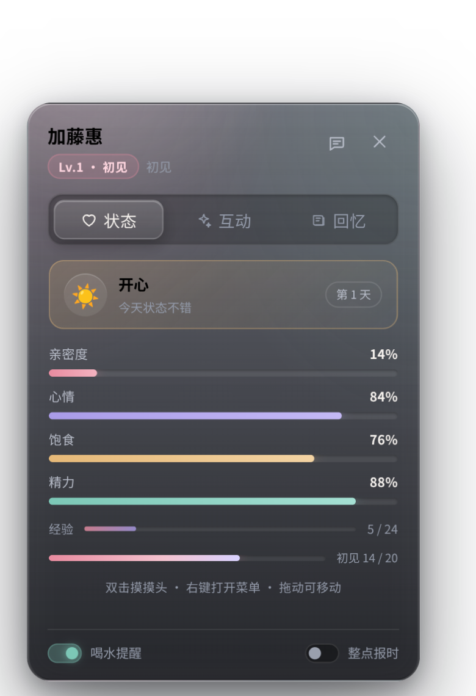
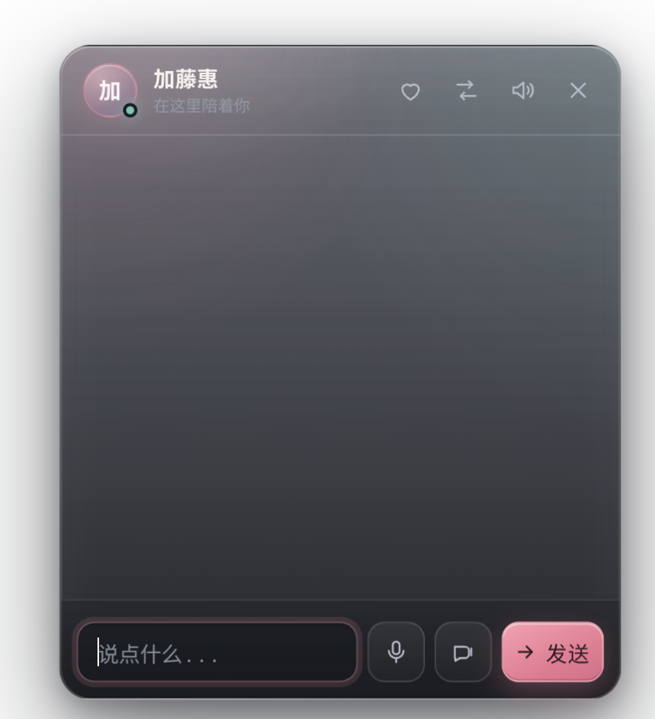

# AnimePet v4 · iOS Liquid Glass 材质与动效

> `/orch-add-feature` Phase 1–2 产物（Research → Plan），Size = **standard**。
> 实现完成后追加了验收记录。

## 1. Research

Apple 在 iOS 26 引入的 Liquid Glass 由五部分组成（[html-in-canvas 拆解](https://html-in-canvas.dev/liquid-glass-effect/)）：

1. 半透明与模糊（translucency + blur）
2. 折射（refraction，玻璃作为透镜位移背景）
3. 色散（chromatic aberration，边缘轻微 RGB 分离）
4. 镜面高光（specular highlight，边缘受光）
5. 随交互轻微形变（motion / warping）

Web 端的现实约束：

- 真折射依赖 `backdrop-filter: url(#svg-filter)`，目前基本只有 Chromium 支持；WebKit 存在未修复的 [Bug 245510](https://github.com/realchendahuang/FlareMo/blob/main/docs/liquid-glass-design.md)，Safari 26/27 都不支持。
- 本项目是 WebKitGTK + 透明 WebView：`backdrop-filter` 只能采样页面内部内容，采样不到桌面合成结果；透明背景上真折射也没有可采样的背景。
- 社区实践（[Liquid Glass CSS 配方](https://theplusaddons.com/blog/liquid-glass-ui/)）普遍采用「分层降级」：**半透明底 + 模糊 + 多层 inset 高光 + 镜面描边**，不做折射层。

结论：采用 baseline 配方 + iOS 弹簧动效，不引入 SVG 位移贴图（WebKit 不可用，且透明 WebView 无背景可采样）。

## 2. Design

### 2.1 材质（`.surface`）

- 两层渐变底色：白色高光层（顶部 7%）+ 深色玻璃层（30% → 86%），保证在浅色桌面上文字仍然可读
- **不使用 `backdrop-filter`**：WebKitGTK 下它会破坏 WebGL 画布绘制，导致桌宠模型不可见（详见 §6）
- 静态镜面高光：面板顶部的白色径向渐变 + 多层 inset 阴影（顶部 1px 亮边、左右 1px 微光、底部压暗）
- 投影只向下：`0 30px 70px -24px` 大模糊 + 负 spread，避免面板上方出现深色光晕/黑边
- 不再使用 `::before`/`::after` 覆盖层：WebKitGTK 在 `backdrop-filter` 元素上叠加伪元素时会卡住首次绘制（见 §6）
- 指针跟随反光暂不启用，避免为玻璃面板叠加额外的合成层

### 2.2 动效（iOS 弹簧）

- 统一弹簧曲线 `cubic-bezier(.22, 1.28, .36, 1)`
- 面板入场：`opacity 0→1` + `translateY(10px)` + `scale(.955→1.006→1)`，340ms
- 右键菜单 / 猜拳弹窗 / toast 同样走弹簧，替代原来的 ease-out
- 按钮：hover 抬升 `scale(1.02)`，press 压到 `scale(.92–.94)`，松手回弹
- Tab 指示器：渐变胶囊 + 内高光，切换时先 `scaleX(1.06) scaleY(.93)` 再弹回，模拟液态玻璃被推动的挤压
- 全部动效尊重 `prefers-reduced-motion`

### 2.3 落点

聊天面板、陪伴中心、右键菜单、猜拳卡片、Tab 栏与指示器、输入框、toast 统一材质；按钮与列表项保持玻璃底 + 高光描边。

## 3. 验收

- [x] 面板使用分层渐变 + 顶部径向高光 + 多层 inset 阴影模拟玻璃
- [x] 页面 `app_ready` 与模型 `model_ready` 双信号；1.5s 页面看门狗 + 10s 模型看门狗
- [x] Tab 指示器切换时出现挤压态并在 380ms 后复位
- [x] 面板/菜单/弹窗入场使用弹簧曲线
- [x] reduced-motion 下不启用指针反光与长动画
- [x] 浅色壁纸下正文对比度仍可读（muted 色提高到 `#b7bcc8` / `#9299a8`）
- [x] 原有功能（tab、礼物、签到、热区并集、聊天）无回归

## 4. 界面预览

| 状态页 | 聊天面板 |
| --- | --- |
|  |  |

## 5. 验证结果（2026-11-08）

| 项目 | 结果 |
| --- | --- |
| 功能回归 | tab 指示器/页面切换、礼物、回忆、热区并集、聊天开关、零脚本错误 |
| 视觉验收 | 彩色壁纸下玻璃透色、描边受光、正文可读；聊天/状态/互动/回忆四页无溢出 |
| 真机 | WebKitGTK 下透明 WebView 正常渲染，无布局回归 |

## 6. 模型不可见根因（2026-11-08 修复）

用户反馈「模型没显示出来」。最终定位到两层原因：

1. **首次加载卡顿**：WebKitGTK 在 `backdrop-filter` 元素上叠加覆盖伪元素时会卡住首次绘制 12–60 秒，页面 JS 不执行。移除伪元素 + 静态资源 `no-store`（避免缓存旧 CSS）后恢复到 0.1–0.4 秒。
2. **模型绘制被破坏**：即使页面正常、DOM 与 HUD 都能渲染，`backdrop-filter` 仍会让 **Live2D 的 WebGL 画布不绘制**（模型区域透明）。逐项对照确认：去掉 `backdrop-filter` 后模型立刻出现。

修复：**彻底移除 `backdrop-filter`**，玻璃感由分层渐变、镜面高光与 inset 阴影模拟；同时保留弹簧动效、启动提示与 1.5 秒看门狗 reload。

## 7. 启动卡顿排查记录

- 定位方式：按「关闭伪元素」「只关 backdrop-filter」「两者都关」逐组对照，确认是两者共存触发首次加载卡死。
- 二次确认：Rust 端打印 HTTP 请求后发现首次启动**根本没有请求 CSS**——WebKit 用了缓存里的旧版 `pet.css`（正是带伪元素 + backdrop-filter 的版本）。本地服务器此前没有缓存头。
- 修复 1：移除 `.surface::before` / `.surface::after`，改用静态渐变 + inset 阴影。
- 修复 2：所有静态资源统一 `Cache-Control: no-store`，避免 WebKit 复用旧 CSS/JS 导致界面更新不生效或旧样式卡启动。
- 兜底：`boot-hint` 启动提示 + Rust 侧页面/模型双看门狗；`load_uri` 在 WebView realize 时触发，并有 500ms 兜底。
- 实测：修复后 release 版从 `load_uri` 到 `app_ready` 约 0.16 秒；HUD 打开后玻璃面板正常透出桌面。

## 8. 已知限制

- 不做真模糊/折射/色散：WebKit 不支持 SVG backdrop-filter，且 WebKitGTK 的 `backdrop-filter` 会破坏 WebGL 模型绘制；玻璃感用分层渐变 + 高光模拟。
- 面板底色偏暗以换取可读性；如想让玻璃更透，可调 `.surface` 第二层渐变的 alpha。
- 面板底色偏暗以换取可读性；如想让玻璃更透，可调 `--lg-blur` 与 `.surface` 第二层渐变的 alpha。
